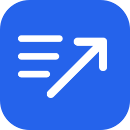

# App Store Release Tools

Заполняет «Что нового» в черновике: копирует опубликованные тексты или использует вставленную таблицу переводов.

## Настройка

Нужны Node.js 22+, доступ к приложению и API-ключ App Store Connect.

1. В [App Store Connect](https://appstoreconnect.apple.com/) откройте профиль → **Individual API Key** → **Generate API Key**. Скачайте `.p8` и сохраните **Key ID**. Если ключ уже создан, используйте его.
2. Сохраните `.p8` вне репозитория: Apple позволяет скачать его только один раз.
3. Скопируйте `asc-config.example.json` в `.asc-config.json` и укажите Key ID и путь к `.p8`. Для командного ключа также добавьте `issuerId`.

В Windows укажите путь через `/`, например `C:/Users/User/Downloads/AuthKey_KEY_ID.p8`.

Не отправляйте ключ другим. `.asc-config.json` и файлы `.p8` исключены из Git.

Для работы с ИИ-агентом откройте проект и попросите заполнить «Что нового». Codex обнаружит проектный скилл в новой сессии; другому агенту можно указать файл `.agents/skills/app-store-release/SKILL.md`.

## Запуск

### Веб-версия двойным кликом

1. Откройте папку `app-store-release-tools`.
2. На Mac запустите `Start.command`, на Windows — `Start.bat`.
3. В браузере выберите приложение и источник, сравните тексты и подтвердите сохранение.
4. Результаты операций отображаются в терминале. Для остановки закройте его окно.

Если браузер не открылся, перейдите по адресу из окна терминала.

### Веб-версия через терминал

1. Откройте терминал в папке `app-store-release-tools`.
2. Выполните `npm run web`.
3. Выберите приложение и источник, сравните тексты и подтвердите сохранение. Для остановки нажмите `Ctrl+C`.

### Терминальная версия

1. Откройте терминал в папке `app-store-release-tools`.
2. Выполните `npm start`.
3. Выберите приложение, платформу и источник, проверьте сравнение и подтвердите сохранение. При вставке таблицы завершите ввод точкой на отдельной строке.

## Таблица переводов

Выберите источник «Таблица с переводами» и вставьте таблицу с языками строками или столбцами. Подходят Markdown и данные, скопированные из таблицы. В веб-версии кнопка «Скопировать промпт» появляется после выбора приложения и платформы; в терминале промпт появляется после выбора таблицы как источника. В нём уже указаны языки выбранного черновика.

Базовый промпт:

> Подготовь короткий текст «Что нового» для App Store. Изменения: [опишите изменения]. Переведи текст для каждой локализации: [названия языков]. Верни только Markdown-таблицу с двумя столбцами «Язык» и «Что нового». В первом столбце укажи точное название языка из списка, во втором — перевод. Сохрани смысл и не добавляй неподтверждённых изменений.

Используйте точные названия из промпта, например «английский (США)». Если название не распознано или неоднозначно, исправьте таблицу и повторите сравнение; в терминале потребуется перезапуск. Распознанные языки, которых нет в черновике, показываются как пропущенные; языки без перевода в таблице остаются без изменений.

## Как работает

- Нужен черновик в статусе **Prepare for Submission**. Для копирования из версии также нужна опубликованная версия.
- Для iOS и macOS текущая версия определяется через App Store США. Можно выбрать другую опубликованную версию; для других платформ или если определить текущую не удалось, выберите её вручную.
- Меняется только «Что нового» в черновике и только после подтверждения. Существующие тексты черновика заменяются показанными в сравнении.
- Языки без текста в источнике пропускаются; новые локализации не создаются. При ошибке часть языков может сохраниться — повторный запуск покажет оставшиеся изменения.

Для проверки проекта выполните `npm test`.

## Лицензия

[MIT](LICENSE).
